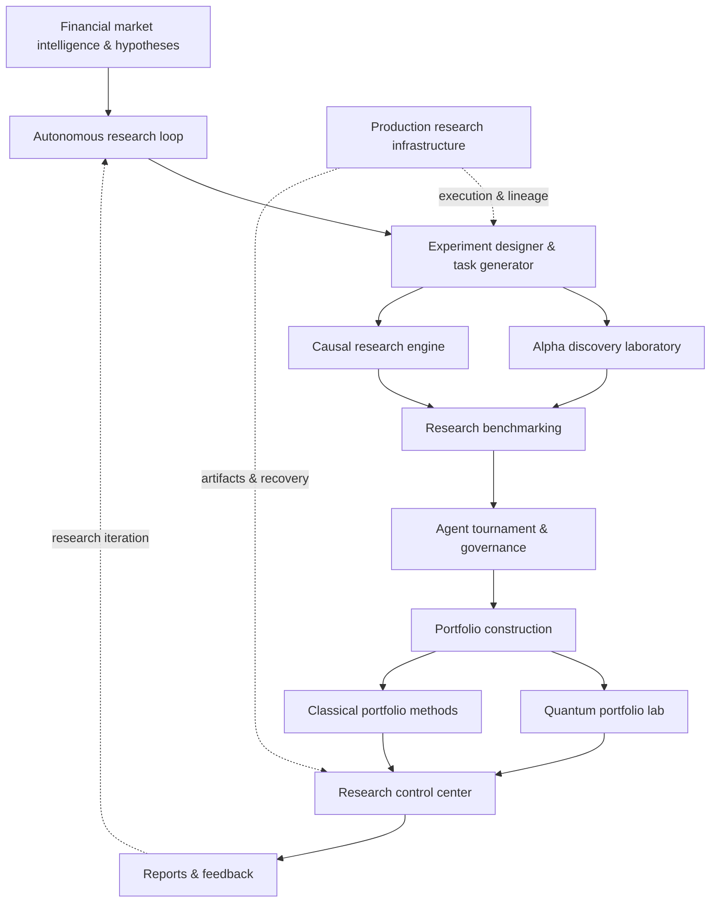

# Autonomous Quantum Financial Research Platform — v7.0.12


**Experimental multi-agent financial research | autonomous experimentation | classical–quantum portfolio optimization**

[](https://github.com/Tamas22-cell/Autonomous-Quantum-Financial-Research)  

> This branch documents the expanded research architecture. The original Multi-Agent Financial Research Platform is maintained in a separate repository. Modules listed below are present in source; full end-to-end runtime integration, benchmark quality, and performance claims have **not** been independently verified.

[Original Multi-Agent platform](https://github.com/Tamas22-cell/AI-Multi-Agent-Financial-Research-Platform) · [This standalone v7.0.12 repository](https://github.com/Tamas22-cell/Autonomous-Quantum-Financial-Research)

## Research mission

Explore a modular workflow for turning market hypotheses into reproducible research experiments, comparing candidate signals and classical / quantum-inspired portfolio approaches, and reviewing results before any strategy is promoted.

The platform is a **research system**, not an autonomous live-trading service.

## Architecture



*Conceptual map of module responsibilities; connections are architectural intent, not proof of a fully integrated execution pipeline.*

## Research modules

| Module | Research scope |
| --- | --- |
| [`autonomous_research_loop/`](autonomous_research_loop/) | Hypotheses, feedback, outcome observation, prioritization, strategy generation and shadow allocation |
| [`autonomous_experiment_designer/`](autonomous_experiment_designer/) | Experiment generation, execution/evaluation scaffolding, continuous tasks, VQE/QAOA experiments |
| [`alpha_discovery_laboratory/`](alpha_discovery_laboratory/) | Candidate generation, feature discovery, alpha lineage, overfitting checks |
| [`causal_research_engine/`](causal_research_engine/) | Event studies, diagnostic evidence, falsification and causal hypotheses |
| [`research_benchmarking/`](research_benchmarking/) | Bootstrap, Monte Carlo, walk-forward/out-of-sample, multiple-testing and robustness checks |
| [`agent_tournament/`](agent_tournament/) | Agent scoring, comparison, promotion controls and rollback |
| [`portfolio_construction/`](portfolio_construction/) | Mean–variance, CVaR, risk parity, drawdown, robust and scenario methods |
| [`quantum_portfolio_lab/`](quantum_portfolio_lab/) | QUBO modeling, classical and hybrid solvers, QAOA and comparative benchmarks |
| [`production_research_infrastructure/`](production_research_infrastructure/) | Artifact/data registries, contracts, event bus, lineage, parallel execution and recovery |
| [`research_control_center/`](research_control_center/) | Experiment registry, decision lineage, alpha library, research monitoring and dashboard scaffolding |

## Research lifecycle

1. **Hypothesis:** define a measurable market or portfolio research question.
2. **Experiment:** propose candidate methods and evaluation protocols.
3. **Validation:** compare out-of-sample results, stability, uncertainty and drawdown.
4. **Governance:** review evidence, score agents and record promotion decisions.
5. **Portfolio research:** compare classical benchmarks against QUBO/QAOA or hybrid approaches.
6. **Feedback:** register artifacts, outcomes and follow-up research tasks.

A quantum method is not assumed to outperform a classical optimizer. The relevant scientific question is whether a measured advantage survives matched constraints, budgets and out-of-sample testing.

## Version highlights

The checked-in history identifies the following development milestones:

| Milestone | Research focus |
| --- | --- |
| **v7.0.10** | Classical–quantum optimization |
| **v7.0.11** | Outcome attribution and meta-learning |
| **v7.0.12** | Continuous research task generation |

The Git branch name is `v7.0.12-autonomous-research`; version references here describe developer milestones, **not** a published benchmark certification.

## Local development

Clone the branch without replacing the default `main` version:

```powershell
git clone https://github.com/Tamas22-cell/Autonomous-Quantum-Financial-Research.git
cd AI-Multi-Agent-Financial-Research-Platform
python -m venv .venv
.\.venv\Scripts\Activate.ps1
python -m pip install --upgrade pip
```

> **Dependency caveat:** The branch's `requirements.txt` was empty when this README was prepared. Before running the entire research stack, dependencies and optional quantum backends must be enumerated and pinned. Do not treat a successful environment creation as proof that every module can execute.

To perform a non-executing Python syntax check on the research modules:

```powershell
python -m compileall -q agent_tournament alpha_discovery_laboratory autonomous_experiment_designer autonomous_research_loop causal_research_engine portfolio_construction production_research_infrastructure quantum_portfolio_lab research_benchmarking research_control_center
```

After installing the *actual* dependencies, a test discovery attempt can be made with `python -m pytest`. This README does not assert that the full suite currently passes.

## Validation and engineering priorities

- Pin and document dependencies, Python versions and supported quantum backends.
- Run CI tests and identify placeholder or empty implementations before claiming production readiness.
- Add reproducible benchmark datasets, seed controls, baselines, hardware/simulator disclosure and runtime/cost metrics.
- Verify signal provenance and prevent look-ahead bias, survivorship bias and data leakage.
- Keep credentials, raw databases, environment files and generated local artifacts out of public commits.
- Document interfaces and deployment permissions before exposing research services through MCP tools.

## Scope and limitations

This repository is intended for **education, experimentation and quantitative research**. No verified investment returns, quantum speedup, production SLA or live-trading safety guarantees are claimed. Market research is not investment advice.

## Maintainer

**Tamás Németh** · AI agents · Python · quantitative finance · blockchain intelligence · classical–quantum research
